# 食堂竖屏状态机

> 本文只写**状态 / 转移 / 跳转 / 业务门闩**，不写视觉、布局、字号、截图对照、人体工程学。
> 本文是**食堂竖屏工作台的完整设计态状态机**（含闭环转移），用作各端（Web 窄屏 / Android 等）适配清单与用户测试权威来源。
> §实现对照只反映进度，不以现状裁剪上文状态/转移。
> 行为权威仍以 `docs/requirements-phase1.md` 为准；IA 见 `canteen-portrait.md`。
> 约定：`me = GET /api/me`；`W = 工作台能力`；`401 = 会话失效`。
> 范围：本文=食堂竖屏工作台（含宽屏对照注）；不含员工壳内部页状态机；登录方法子状态不含。

## 1. 状态列表

### S0 会话与壳路由

- `S0_INIT`：启动，会话未判定。
- `S0_LOADING`：`me` 拉取中。
- `S0_LOGIN`：未登录（停留在登录/注册；Passkey/TOTP/邮箱 OTP/密码均收敛为登录成功事件，方法内锁次/冷却子状态不属本文）。
- `S0_CANTEEN`：食堂壳（`W == true`）。
- `S0_EMPLOYEE`：员工壳（`W == false` 且有员工能力）。
- `S0_DENY`：错误页「账号无可用功能」＋退出。
- `S0_EXPIRED`：`401`（任何状态可进，见 T0）。

`W` 定义（任一命中）：`roles ∋ {canteen, admin, super_admin}`，
或 `permissions ∩ {menu.read, menu.write, optimizer.read, meal.admin_override, rating.admin_read,
comment.admin_read, user.invite, export.run, audit.read, system.super,
rating.strong_alert_config, user.recover} ≠ ∅`。

### S1 食堂范围（壳内全局条件）

- `S1_NONE`：可管食堂集合为空；人数/选菜/菜谱均进空态「没有可管理的食堂」（可引导联系超管）。
- `S1_SINGLE`：恰 1 个（范围恒定，无需选择事件）。
- `S1_MULTI(c)`：≥2 个，当前值为 `c`（`super_admin` 取全量，其余按 `roles[].canteen_ids` 过滤）。

### S2 人数

- `S2_LOADING(c, d)`：拉取 `(canteen=c, date=d)` 中。
- `S2_READY(c, d, locked)`：有数，`locked ∈ {true, false}`（整日一次，不按餐分）。
- `S2_ERROR(c, d)`：拉取失败（可重试/切日/切食堂恢复）。
- `S2_EMPTY`：`S1_NONE` 时的空态「没有可管理的食堂」（可引导联系超管）。

### S3 选菜

- `S3_WEEK(w)`：周视图（`w` 为周偏移，`0` 为本周；`周一..日 × {早,午,晚}` 格集合）。
- `S3_MEAL(m)`：当餐选定（`m` 为某一 `(day, slot)`）。
- `S3_SAVING(m, delta)`：勾选 `delta` 写回中。
- `S3_LOADING(x)`：拉取中（`x` 为周偏移 `w` 或当餐 `m`）。
- `S3_ERROR(x)`：拉取失败（可重试回 LOADING）。
- `S3_NOPERM`：`¬optimizer.read`（宽屏侧栏条目隐藏；竖屏 Tab 常显，进后拉取失败 toast，无阻断）。

### S4 菜谱

- `S4_LIST(f)`：列表（`f ∈ {菜,饭,汤}` 为当前分组条件）。
- `S4_ERROR(f)`：列表 `(f)` 拉取失败（可重试或重进恢复）。
- `S4_EDIT(id?)`：编辑（`id` 为空＝新建；类型 `∈ {菜,饭,汤}`，启用 `∈ {on, off}`）。
- `S4_CONFIRM_OFF(id)`：停用待确认（`on → off` 必经，不可跳过）。
- `S4_SAVING(id)`：表单写回中。
- `S4_READONLY`：`¬menu.write`（MenuPage 无写门：新建/停用按钮照常可点，失败靠后端 403 toast；仅宽屏侧栏“编辑菜”条目隐藏）。

### S5 反馈与管理（更多子节点）

- `S5_MORE`：更多根（各子项按权限码显隐，空组不出现）。
- `S5_ALERT`：强提醒（表格＋刷新；「去停用」深链 → `S4_EDIT/CONFIRM_OFF`，不自动下架）。
- `S5_RATING` / `S5_COMMENT`：评分汇总 / 评语（只读分支；评语无删除转移）。
- `S5_OVERRIDE`：截止后改单（需 `meal.admin_override`），最小子转移：
  `OV_LOAD(target) --载入成功--> OV_EDIT --改--> OV_SAVE --保存成功--> OV_EDIT'`；
  `--载入失败--> OV_LOAD`（重试）或 `--返回--> S5_MORE`；`--保存失败--> OV_EDIT`（保留参数，可再存）。
- `S5_ACCOUNT`：账户（人人可进；`username` 只读，改 `display_name`）；`S5_DEVICE`（Web 需 `device.approve`）。
- 总管组（后置；边存在条件＝对应权限码；Web 已有 / Android 未做）：
  `S5_EXPORT`（`export.run`）／`S5_AUDIT`（`audit.read`）／`S5_EMAIL`（`system.super`）／
  `S5_THRESHOLD`（`rating.strong_alert_config`）／`S5_RECOVER`（`user.recover`）／
  `S5_LLM`（`system.super`）／`S5_APP_SIGN`（`system.super`）／`S5_CREATE_CANTEEN`（超管；宽屏/竖屏入口形态可不同）。

### S6 邀请码（明文展示一次，可多次注册）

- `S6_LIST`：已有码集合（逐码 `∈ {使用中, 已用完, 已作废}`，由 `used_count/max_uses/revoked_at` 决定）。
- `S6_EDIT`：创建参数态（角色 `∈ {员工,食堂}`，食堂范围，次数；canteen 码必须≥1 食堂范围，employee 码须空范围）。
- `S6_CREATED_UNSHOWN`：已创建、码未展示。
- `S6_SHOWN`：已展示一次（码不再重显；关对话框回 `S6_LIST`）。
- `S6_REVOKED(id)`：已作废（终态，不可再用于注册）。

### S7 双角色位置

- `S7_CANTEEN`：位于食堂壳（默认）。
- `S7_EMPLOYEE`：位于员工壳。
- 互切只改本地位置，不触会话（无登录事件）。

## 2. 状态变化（转移）

`源 --事件/条件--> 目标`。权限不足的转移直接不存在（节点不可达；宽屏条目隐藏，竖屏见 S3/S4 的失败 toast 说明）。

### T0 会话/路由

- `S0_INIT --启动--> S0_LOADING`。
- `S0_LOADING --me 拉取成功 ∧ W--> S0_CANTEEN`（双角色默认进此分支）。
- `S0_LOADING --me 拉取成功 ∧ ¬W ∧ 有员工能力--> S0_EMPLOYEE`。
- `S0_LOADING --me 拉取成功 ∧ 皆无能力--> S0_DENY`。
- `S0_LOADING --未登录--> S0_LOGIN`。
- `S0_LOGIN --登录/注册成功 ∧ me(W)--> S0_CANTEEN`；`--登录/注册成功 ∧ me(仅员工)--> S0_EMPLOYEE`。
- `ANY --401--> S0_EXPIRED --清会话--> S0_LOGIN`。
- `S0_DENY --退出--> S0_LOGIN`。
- `S0_CANTEEN --页签事件--> S0_CANTEEN`（人数⇄选菜⇄菜谱⇄更多；仅 sub===tabs，子页中底栏隐藏）。

### T1 范围

- `进壳 --managedCanteens()==∅--> S1_NONE`；`==1--> S1_SINGLE`；`≥2--> S1_MULTI(c0)`（`c0` 为首个）。
- `S1_MULTI(c) --选择 c'--> S1_MULTI(c')`（切食堂后人数/选菜/菜谱/更多子页全部跟 `c'` 重拉）。
- `S1_NONE --超管建食堂成功--> S1_SINGLE/S1_MULTI`（超管经建食堂入口；宽屏/竖屏入口形态可不同）。

### T2 人数

- `S1_SINGLE/S1_MULTI(c) --进入/切日 d--> S2_LOADING(c, d)`（`d` 默认上海时区今天；切日：Web 日期选择、Android ±1天）。
- `S1_MULTI(c) --选 c'--> S1_MULTI(c') --范围生效--> S2_LOADING(c', d)`（`d` 保持当前日期）。
- `S2_LOADING --headcount 返回--> S2_READY(c, d, locked)`。
- `S2_LOADING --失败--> S2_ERROR --重试/切日/切食堂--> S2_LOADING`。
- `S2_READY(c, d, _) --切日 d'--> S2_LOADING(c, d')`。
- 门闩：`locked` 为整日值，**不存在按餐锁定的状态**；锁定判定只读 `headcount.locked`。

### T3 选菜

- `S3_WEEK(w) --上周/下周--> S3_LOADING(w') --拉取成功--> S3_WEEK(w')`；
  `--拉取失败--> S3_ERROR(w') --重试--> S3_LOADING(w')`。
- `S3_WEEK --点格 m--> S3_LOADING(m) --当餐成功--> S3_MEAL(m)`；
  `--当餐失败--> S3_ERROR(m) --重试--> S3_LOADING(m)`；`S3_MEAL --返回--> S3_WEEK`。
- `S3_MEAL(m) --勾选/取消 delta--> S3_SAVING(m, delta) --写回成功--> S3_MEAL(m')`
 （`m'` 为更新后集合；失败留 `S3_MEAL(m)`，选择不变，失败 toast）。
- `S3_MEAL(m) --下一餐--> S3_MEAL(next(m))`（`jump()` 只切 date/slot，不经 SAVING；`next` 由当餐接口下发）。
- `¬optimizer.read --宽屏--> 条目隐藏；--竖屏--> S3_WEEK/S3_MEAL 照常进，拉取失败 toast`（竖屏 OptimizePage 无权限门）。
- 门闩：勾选即时写回（无“暂存再提交”状态）；偏好值不进入状态（无分数展示态）。

### T4 菜谱

- `S4_LIST(f) --切分组 f'--> S4_LIST(f')`。
- `S4_LIST --点行 id--> S4_EDIT(id)`；`--新建--> S4_EDIT(∅)`（新建＝空 `id`，默认 `启用=on`）。
- `S4_LIST --行内启停--> S4_LIST`（`toggle` 直接 PUT；`on→off` 先确认，`off→on` 直接；成功重拉，失败 toast）。
- `S4_EDIT --保存--> S4_SAVING --成功--> S4_LIST`；失败回 `S4_EDIT`。
- `S4_EDIT --取消--> S4_LIST`（emit back，与保存成功回列表区分）。
- `S4_EDIT(id, on) --关启用--> S4_CONFIRM_OFF(id) --确认--> S4_SAVING --成功--> S4_LIST`；
  `--取消--> S4_EDIT(id, on)`。
- `S4_LIST(f) --列表拉取失败--> S4_ERROR(f) --重试/重进--> S4_LIST(f)`。
- `off → on` 不经确认也不直达写回：`S4_EDIT(id, off) --开启用--> S4_EDIT(id, on)`（只改本地启用态，须再点保存才进 `S4_SAVING`）；仅 `on → off` 必经 `S4_CONFIRM_OFF`（确认后直接 save）。
- `S5_ALERT --去停用 id--> S4_EDIT(id)`（唯一功能出边；不在列表直接下架）。
- `¬menu.write --宽屏--> “编辑菜”条目隐藏；--竖屏/列表--> S4_LIST 照常进，写操作失败 toast`。

### T5 更多/反馈/管理/账户

- `S0_CANTEEN --进更多--> S5_MORE --选子项--> {S5_ALERT, S5_RATING, S5_COMMENT, S5_OVERRIDE,
  S6_LIST, S5_ACCOUNT, S5_DEVICE, 总管子节点}`（子项存在 ⟺ 对应权限码持有；无码则边不存在）。
- 子节点 `--返回--> S5_MORE`。
- `S5_ACCOUNT --打开设备页--> S5_DEVICE`（`AccountPage @open-devices`）。
- `S5_MORE --退出登录--> S0_LOGIN`（退出事件清会话；确认框属 UI，不入状态机）。
- `S5_ACCOUNT --退出登录--> S0_LOGIN`（embedded 账户页内退出同样清会话）。
- `S5_ACCOUNT --改显示名成功--> S5_ACCOUNT`（名称更新，会话不变）。
- `S5_ACCOUNT --自助改密成功--> S5_ACCOUNT`（保留当前会话，吊销该账号其它全部会话；
  超管找回则吊销全部含当前 → `S0_LOGIN`）。
- 检查更新：本期状态机不含（竖屏更多无此节点；更新能力在员工端复用）。
- 强提醒门闩：`S5_ALERT` 无 `→停用` 边，去停用走深链进菜谱编辑。
- 评语门闩：无删除转移（Web 明示“评语不能删除”）。

### T6 邀请码

- `S6_EDIT --创建成功--> S6_CREATED_UNSHOWN --首次展示--> S6_SHOWN`。
- `S6_SHOWN --关闭对话框--> S6_LIST`（码不重显；需新码重走 `S6_EDIT`）。
- `S6_EDIT --创建失败--> S6_EDIT`（参数保留，可改后重试）。
- `S6_LIST --作废 id--> S6_REVOKED(id)`（需确认；单向，不可恢复）。
- `S6_LIST --改次数（≥已用次数；改到等于已用即用尽）--> S6_LIST`。
- `凭码注册成功 --used_count++--> S6_LIST`（码被作废/用满则注册拒绝；canteen 码的新账号具 W，按 T0 进食堂壳；邀请码不发 admin/super_admin）。
- 门闩：`user.invite` 缺失则 `S6_EDIT` 不可达。

### T7 双角色

- `S7_CANTEEN --切换到员工端--> S7_EMPLOYEE`（条件：持有 `meal.self_read ∨ shift.self_write`）。
- `S7_EMPLOYEE --切换到食堂工作台--> S7_CANTEEN`（条件：`W`）。
- 两转移均无登录/登出事件，会话保持。

## 3. 跳转关系

```mermaid
stateDiagram-v2
  [*] --> S0_LOADING
  S0_LOADING --> S0_CANTEEN : me且W
  S0_LOADING --> S0_EMPLOYEE : me仅员工
  S0_LOADING --> S0_DENY : 皆无能力
  S0_LOADING --> S0_LOGIN : 未登录
  S0_DENY --> S0_LOGIN : 退出
  S0_CANTEEN --> S1_MULTI : 范围≥2
  S0_CANTEEN --> S1_SINGLE : 范围=1
  S0_CANTEEN --> S1_NONE : 范围空
  S1_NONE --> S2_EMPTY
  S1_NONE --> S3_WEEK : 空态
  S1_NONE --> S4_LIST : 空态
  S1_MULTI --> S2_LOADING : 进人数/切食堂/切日
  S1_SINGLE --> S2_LOADING : 进人数/切日
  S2_LOADING --> S2_READY : headcount成功
  S2_LOADING --> S2_ERROR : 失败
  S2_ERROR --> S2_LOADING : 重试/切日/切食堂
  S2_READY --> S2_LOADING : 切日
  S0_CANTEEN --> S3_WEEK : 进选菜
  S0_CANTEEN --> S3_NOPERM : 无码则宽屏隐藏
  S3_WEEK --> S3_LOADING : 切周/点格
  S3_LOADING --> S3_WEEK : 周拉取成功
  S3_LOADING --> S3_MEAL : 当餐拉取成功
  S3_LOADING --> S3_ERROR : 失败
  S3_ERROR --> S3_LOADING : 重试
  S3_MEAL --> S3_SAVING : 勾选即时写回
  S3_SAVING --> S3_MEAL : 写回成功
  S3_MEAL --> S3_MEAL : 下一餐(只切date/slot)
  S3_MEAL --> S3_WEEK : 返回
  S0_CANTEEN --> S4_LIST : 进菜谱
  S0_CANTEEN --> S4_READONLY : 无写码则宽屏隐藏编辑
  S4_LIST --> S4_ERROR : 列表失败
  S4_ERROR --> S4_LIST : 重试/重进
  S4_LIST --> S4_EDIT : 点行/新建
  S4_LIST --> S4_LIST : 行内启停
  S4_EDIT --> S4_CONFIRM_OFF : 关启用(on→off)
  S4_CONFIRM_OFF --> S4_SAVING : 确认
  S4_CONFIRM_OFF --> S4_EDIT : 取消
  S4_EDIT --> S4_SAVING : 保存
  S4_EDIT --> S4_LIST : 取消
  S4_SAVING --> S4_LIST : 成功
  S0_CANTEEN --> S5_MORE : 进更多
  S0_CANTEEN --> S0_CANTEEN : 页签互切(人数/选菜/菜谱/更多)
  S5_MORE --> S5_ALERT : 有码
  S5_ALERT --> S4_EDIT : 去停用
  S5_ALERT --> S5_MORE : 返回
  S5_MORE --> S5_RATING : 有码
  S5_RATING --> S5_MORE : 返回
  S5_MORE --> S5_COMMENT : 有码
  S5_COMMENT --> S5_MORE : 返回
  S5_MORE --> S5_OVERRIDE : 有meal.admin_override
  S5_OVERRIDE --> OV_LOAD : 进入
  OV_LOAD --> OV_EDIT : 载入成功
  OV_LOAD --> OV_LOAD : 载入失败重试
  OV_LOAD --> S5_MORE : 返回
  OV_EDIT --> OV_SAVE : 改
  OV_SAVE --> OV_EDIT : 保存成功/失败
  OV_EDIT --> S5_MORE : 返回
  S5_OVERRIDE --> S5_MORE : 返回
  S5_MORE --> S5_ACCOUNT : 恒有
  S5_ACCOUNT --> S5_MORE : 返回
  S5_ACCOUNT --> S5_DEVICE : 打开设备页
  S5_ACCOUNT --> S0_LOGIN : 退出登录
  S5_MORE --> S5_DEVICE : 有device.approve
  S5_DEVICE --> S5_MORE : 返回
  S5_MORE --> S5_EXPORT : 有export.run(后置)
  S5_MORE --> S5_AUDIT : 有audit.read(后置)
  S5_MORE --> S5_EMAIL : 总管(后置)
  S5_MORE --> S5_THRESHOLD : 有码(后置)
  S5_MORE --> S5_RECOVER : 有码(后置)
  S5_MORE --> S5_LLM : 总管(后置)
  S5_MORE --> S5_APP_SIGN : 总管(后置)
  S5_MORE --> S5_CREATE_CANTEEN : 超管(后置)
  S5_EXPORT --> S5_MORE : 返回
  S5_AUDIT --> S5_MORE : 返回
  S5_EMAIL --> S5_MORE : 返回
  S5_THRESHOLD --> S5_MORE : 返回
  S5_RECOVER --> S5_MORE : 返回
  S5_LLM --> S5_MORE : 返回
  S5_APP_SIGN --> S5_MORE : 返回
  S5_CREATE_CANTEEN --> S5_MORE : 返回
  S5_MORE --> S6_LIST : 有user.invite
  S6_LIST --> S5_MORE : 返回
  S6_LIST --> S6_EDIT : 新建
  S6_EDIT --> S6_CREATED_UNSHOWN : 创建成功
  S6_EDIT --> S6_EDIT : 创建失败
  S6_CREATED_UNSHOWN --> S6_SHOWN : 首次展示
  S6_SHOWN --> S6_LIST : 关闭
  S6_LIST --> S6_REVOKED : 作废
  S6_LIST --> S6_LIST : 改次数
  S6_LIST --> S6_LIST : 凭码注册计数++
  S0_CANTEEN --> S0_EMPLOYEE : 切员工端(本地)
  S0_EMPLOYEE --> S0_CANTEEN : 回工作台(本地)
  S0_CANTEEN --> S0_LOGIN : 退出
  S5_MORE --> S0_EMPLOYEE : 切换到员工端
  S5_MORE --> S0_LOGIN : 退出
  ANY --> S0_EXPIRED : 401
  S0_EXPIRED --> S0_LOGIN : 清会话
```

边清单（与图一致）：登录→壳三分支（含 DENY 错误页）；壳→范围三分支（`S1_NONE`→人数/选菜/菜谱空态）；
范围→人数拉取（切食堂后全页重拉）；人数切日环（失败→ERROR→重试）；
选菜切周/点格经 LOADING，周视图⇄当餐（失败→ERROR→重试）＋写回环＋下一餐（只切date/slot）、`NOPERM` 分支；
菜谱列表 ERROR（重试/重进恢复）、列表⇄编辑、行内启停、
`on→off` 经确认（`off→on` 改本地态须保存）、编辑取消回列表、只读分支；强提醒→编辑深链（不自动下架）；
底栏四页签经页签事件互切（仅 sub===tabs，子页底栏隐藏）；
更多→各子节点（含总管命名态与建食堂）→返回，账户→设备，改单 OV 载入→改→保存子环（含失败重试），更多→员工端；
邀请码列表⇄创建/改次数、创建失败自环、作废单向边、展示后关闭回列表（码不重显）；
账户改名自环、改密会话边、账户内退出；双角色双向本地边；壳/更多/账户退出边；`401` 全局边。

## 4. 实现对照（状态覆盖）

| 状态 / 转移 | Web 窄屏（#27 已合入） | Android | 阶段 |
|-------------|-------------------|---------|------|
| T0 按 `me` 进壳三分支（DENY 错误页），401 全局边 | 401 已接；DENY 未接（进员工壳） | 未接（进员工壳） | C1 |
| T7 双角色互切（无会话事件，默认食堂壳） | 已接 | 已接 | C1 |
| S1 范围三态＋切食堂全页重拉 | 已接 | 半接：顶栏 picked 本地态，人数不跟随（选菜/菜谱 C1 未做） | C1 |
| S2 人数 `LOADING/READY/ERROR/EMPTY`＋整日锁＋切食堂边 | 半接：真数据已接；无独立 ERROR/空态文案（待补） | 半接：真数据+错误行已接；顶栏未绑定（待补） | C1 |
| S3 周视图(w)/切周/LOADING/ERROR/当餐/写回环/下一餐，NOPERM 分支 | 半接：主流程已接；LOADING/ERROR/重试环未接 | 未做 | C3 |
| S4 列表/ERROR/行内启停/编辑/确认停用（仅 on→off；off→on 须保存）/写回环，只读分支 | 半接：主流程已接；ERROR 重试环未接 | 未做（无此状态） | C2 |
| S5 强提醒→去停用深链（不自动下架） | 未接（只读表，无深链） | 未做 | C4 |
| S5 评分/评语只读分支 | 已接 | 未做 | C4 |
| S5 改单分支（`meal.admin_override`） | 已接 | 未做 | C5 |
| S6 创建→未展示→已展示（关闭回列表，码不重显） | 已接 | 未做 | C5 |
| S6 列表/作废/改次数，创建失败自环 | 已接 | 未做 | C5 |
| S5 改单子转移（载入→改→保存，失败重试） | 半接：主流程已接；失败重试环未接 | 未做 | C5 |
| S5 账户改名/改密会话边/账户内退出 | 已接 | 未做（更多账户节点部分实现） | C1 |
| S5 总管命名态 / 分支组（后置；含建食堂） | 半接：更多7项已接；建食堂竖屏入口待补 | 未做 | C5+ |
| S5 更多退出边 | 已接 | 已接 | C1 |
| 检查更新转移 | 不含（本期无此节点） | 不含 | — |
| S5 账户/设备/退出边 | 已接 | 部分：账户名＋双角色边＋退出边已接；设备分支复用员工壳 | C1 |

## 5. 用户测试场景

由上文闭环边/门闩派生，可执行，不写选择器/像素。这些场景将落地为 Gherkin/Playwright/Compose 测试以反哺实现。

| ID | 场景（操作与期望） | 对应转移 | 阶段 | 适用端 |
|----|-------------------|---------|------|-------|
| UT-01 | 工作台账号登录进食堂壳，底栏四页签可见 | T0 | C1 | 两端 |
| UT-02 | 皆无能力账号见 DENY 错误页，退出回登录 | T0 | C1 | 两端 |
| UT-03 | 双角色默认进食堂壳 | T0 | C1 | 两端 |
| UT-04 | 更多→员工端→回工作台，不重登 | T7 | C1 | 两端 |
| UT-05 | 范围三态：0/1/多食堂及默认首食堂 | T1 | C1 | 两端 |
| UT-06 | 切食堂后人数/选菜/菜谱/更多子页全跟新范围 | T1 | C1 | Web |
| UT-07 | 无食堂空态 + 超管建食堂后进单/多态 | T1 | C1 | Web |
| UT-08 | 人数切日，三餐数与锁定行更新 | T2 | C1 | 两端 |
| UT-09 | 人数拉取失败进 ERROR，重试/切日恢复 | T2 | C1 | 两端 |
| UT-10 | 选菜切周，周视图更新 | T3 | C3 | 两端 |
| UT-11 | 点格进当餐，勾选即时保存 | T3 | C3 | 两端 |
| UT-12 | 选菜拉取/写回失败进 ERROR，重试恢复 | T3 | C3 | 两端 |
| UT-13 | 下一餐只切 date/slot | T3 | C3 | 两端 |
| UT-14 | 无 optimizer.read 进选菜受限（隐藏或说明） | T3 | C3 | 两端 |
| UT-15 | 菜谱切分组，列表更新 | T4 | C2 | 两端 |
| UT-16 | 新建菜品保存进列表 | T4 | C2 | 两端 |
| UT-17 | 点行编辑保存 | T4 | C2 | 两端 |
| UT-18 | on→off 停用须确认；off→on 开启用后须保存 | T4 | C2 | 两端 |
| UT-19 | 列表行内启停直接生效 | T4 | C2 | 两端 |
| UT-20 | 列表拉取失败恢复 | T4 | C2 | 两端 |
| UT-21 | 强提醒经去停用深链进编辑，不自动下架 | T4/T5 | C4 | 两端 |
| UT-22 | 改单载入→改→保存成功 | T5 | C5 | 两端 |
| UT-23 | 改单载入/保存失败重试（参数保留） | T5 | C5 | 两端 |
| UT-24 | 邀请码创建后明文只展示一次 | T6 | C5 | 两端 |
| UT-25 | 作废/改次数状态流转 | T6 | C5 | 两端 |
| UT-26 | 凭码注册：作废/用满拒绝；canteen 码进食堂壳 | T6/T0 | C5 | 两端 |
| UT-27 | 改显示名；改密保留当前吊销其它；退出回登录 | T5 | C1 | 两端 |
| UT-28 | 设备页往返 | T5 | C1 | Web |
| UT-29 | 任意页 401 回登录 | T0 | C1 | 两端 |
| UT-30 | 总管组按码显隐；超管建食堂 | T1/T5 | C5 | Web |
| UT-31 | 评分/评语只读展示 | T5 | C4 | 两端 |
