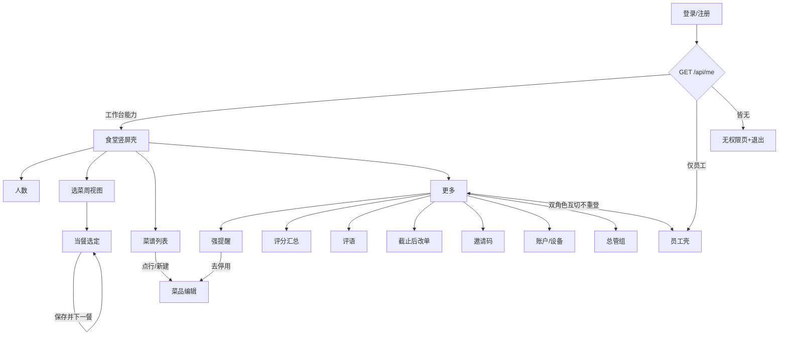

# 食堂竖屏：页面 / 内容 / 跳转清单

> 设计权威仍是 `canteen-portrait.md`（PR #27 未合入，先看该分支同名文件）与一期需求 `docs/requirements-phase1.md`。
> 本文只把那份设计的**页面、状态、跳转**展开成可对照实现的清单，不新增产品行为。
> 视觉竖屏稿：`docs/ui/canteen-portrait-mock/`（PR #27 新增，master 暂无）；横屏主参考：`docs/ui/README.md`。

## A. 路由根

登录 / 注册页（与员工端共用：Passkey 默认，失败回退密码；邮箱仅 OTP）→ `GET /api/me` 成功后：

- 有**工作台能力** → 食堂竖屏壳。判定任一命中：角色含 `canteen` / `admin` / `super_admin`，
  或权限含运营 / 总管码（`menu.read` / `menu.write` / `optimizer.read` / `meal.admin_override` /
  `rating.admin_read` / `comment.admin_read` / `user.invite` / `export.run` / `audit.read` /
  `system.super` / `rating.strong_alert_config` / `user.recover` 等，与 Web 侧栏 `show` 条件同思路）。
- 仅员工自助能力（`meal.self_read` / `meal.self_write` / `shift.*`）→ 员工壳。
- 两者皆无 → 无权限页（「账号无可用功能」＋退出）。
- 双角色（员工＋工作台）默认进**食堂壳**；食堂壳「更多」↔ 员工壳「我的」互切，**只改本地导航根，不重登**。
- 401 → 清会话回登录（与员工端相同）。
- Web 窄屏另看 viewport：`matchMedia('(max-width: 900px)')`（`web/src/narrow.ts`，不断 UA），
  窄屏进竖屏壳、宽屏进现有侧栏；Android 不分宽窄，同包按账号进壳。

## B. 页面清单

写法统一为：页面名 / 入口 / 必须展示的内容 / 主要状态变化 / 主操作 / 权限显隐 / 去向 / 设计关系。

### B0. 壳层（四 Tab＋顶栏）

- **页面名**：食堂竖屏壳（含顶栏＋底部四 Tab：人数｜选菜｜菜谱｜更多）。
- **入口**：路由根判工作台能力后进入；双角色从员工壳「切换到食堂工作台」进入。
- **必须展示的内容**：顶栏（食堂范围，见 B1）＋当前 Tab 内容＋底部四 Tab。
- **主要状态变化**：Tab 切换只换本地 `tab`，不重登；更多子页（Web）切 `sub` 并隐藏底栏，左上返回。
- **主操作**：四 Tab 切换；顶栏切食堂（≥2 个时）。
- **权限显隐**：壳本身要求工作台能力；各 Tab/更多子项再按权限码显隐（见下）。
- **去向**：Tab 互切；更多 → 各子页 → 返回；双角色 → 员工端。
- **设计关系**：对齐 `canteen-portrait.md` §2.1；竖屏稿四屏；横屏侧栏的竖屏收纳（选菜独立 Tab，评分/强提醒/评语/改单/邀请收进更多）。

### B1. 顶栏食堂范围

- **页面名**：顶栏食堂范围（不是独立页，随壳展示）。
- **入口**：壳顶栏常驻。
- **必须展示的内容**：当前食堂名称；≥2 个时为选择器。
- **主要状态变化**：
  - 仅 1 个：只读展示名称（Web：`el-select` 仍渲染但选项唯一；Android：`Text` 只读）。
  - ≥2 个（含 `super_admin` 全局）：选择器，切换后子页共用范围（Web：`auth.canteenId` 全局；`managedCanteens()` 按角色 `canteen_ids` 过滤，`super_admin` 全量）。
  - 无可管食堂：人数/选菜/菜谱空态「没有可管理的食堂」，引导联系超管（超管建食堂在后置总管组）。
- **主操作**：切换食堂。
- **权限显隐**：范围来自 `roles[].canteen_ids`（`super_admin` 不限）。
- **去向**：不跳转，只改范围。
- **设计关系**：对齐 `canteen-portrait.md` §2.2；Web 对齐横屏 `managedCanteens()`。
- **实现如实注**：Android C1 顶栏 `picked` 是 `CanteenTopBar` 本地状态，**未与人数页绑定**；
  人数页 `canteenId` 独立取 `allCanteens().first()`（见 §C）。顶栏切换 C1 不影响人数数字，待后续迭代绑死。

### B2. 人数 Tab

- **页面名**：人数（就餐人数总览）。
- **入口**：壳底栏「人数」。
- **必须展示的内容**：所选日期早 / 午 / 晚**有效报餐人数**三张大卡（数字为主）；日期行（‹ 日期 ›）；
  锁定行一行。
- **主要状态变化**：
  - 日期默认上海时区今天，可左右切日。
  - 锁定行：`该日三餐已锁定` / `尚未锁定`。**一次锁定次日三餐，不按餐次分锁**；
    不做「午餐锁、晚餐未锁」，不做分类占比装饰统计。
  - 空 / 错态：无食堂空态（见 B1）；网络失败显示错误行＋可重试（切日重拉）。
- **主操作**：切日（无其它主操作）。
- **权限显隐**：壳内常显（横屏侧栏要求 `menu.read` / `optimizer.read` / `meal.admin_override` / `system.super` 任一；竖屏壳已要求工作台能力）。
- **去向**：不跳转。
- **设计关系**：对齐横屏 `OverviewPage` 同接口（`GET /api/canteens/{id}/headcount`）；
  对齐竖屏稿 `headcount.png`；需求「北京时间提前一天锁次日三餐」。

### B3. 选菜 Tab

- **页面名**：选菜（选菜优化）——周视图＋当餐选定页。
- **入口**：壳底栏「选菜」。
- **必须展示的内容**：
  - 周视图：周一～周日 × 早 / 午 / 晚格子；格内菜 / 饭 / 汤摘要**分开**，不混一行。
  - 当餐选定页：三类分节列表（菜｜饭｜汤）；卡片可有图 / 中性占位＋口味标签。
- **主要状态变化**：格子选中态；当餐三类勾选态；保存中态。
- **主操作**：点格子进当餐页；勾选 / 取消**立即保存**；主按钮「保存并下一餐」按需求顺序跳转。
- **权限显隐**：无 `optimizer.read` 时 Tab 隐藏或进 Tab 后说明无权限。
- **去向**：周视图 → 当餐选定页 → 下一餐；返回周视图。
- **设计关系**：
  - 对齐横屏 `OptimizePage` 同接口；竖屏稿 `optimize.png`。
  - 色阶**只表暗线偏好高低**（更高更绿、更低更红）；不展示偏好分 / Elo /「预计评分」/ 倾向权重；
    口味标签只作辅助，不替代排序和色阶；员工端不展示排行（AGENTS.md 约束）。

### B4. 菜谱 Tab

- **页面名**：菜谱（列表＋编辑，新建与编辑同一表单）。
- **入口**：壳底栏「菜谱」；强提醒「去停用」深链进编辑。
- **必须展示的内容**：
  - 列表：菜｜饭｜汤分段（页签或分节，强制分组）；行含名称、启用状态、可选缩略图（无图用中性占位）。
  - 表单：类型仅菜 / 饭 / 汤；口味标签（食堂用 `menu.write` 维护）；图片上传 / 更换 / 移除（非必填）；
    启用开关；**无备注字段**；新建是同一页的空表，默认启用。
- **主要状态变化**：启用 / 停用态；上传中；保存中；停用需确认（不在列表直接下架）。
- **主操作**：右上或 FAB「新建」（需 `menu.write`）；点行进编辑；保存。
- **权限显隐**：列表需 `menu.read` 系能力；新建 / 编辑需 `menu.write`。
- **去向**：列表 → 编辑（`dishId` 为空即新建）→ 返回列表；强提醒 → 编辑并聚焦启用开关。
- **设计关系**：对齐横屏 `MenuPage`＋`DishEditPage` 同接口；竖屏稿 `menu.png`；
  对齐横屏菜品终稿（编辑菜布局即新建空表）；口味标签挂菜品上。

### B5. 更多（分组列表）

- **页面名**：更多（Apple Settings 式分组列表，Web 有子页，Android C1 仅占位＋账户）。
- **入口**：壳底栏「更多」。
- **必须展示的内容**（按权限显隐，空组不展示）：
  - **反馈**：强提醒、评分汇总、评语。
  - **管理**：截止后改单、邀请码。
  - **账户**：账户设置、设备与 Passkey、检查更新（Android）、切换到员工端（仅双角色）、退出登录。
  - **总管（后置可标）**：导出、审计、邮箱、阈值、找回、LLM、应用签名、建食堂。
- **主要状态变化**：组随权限增减；子页内各自加载 / 空 / 错态。
- **主操作**：点行进子页；退出需确认（Web 用 `ElMessageBox`，Android 直接退）。
- **权限显隐**（与横屏侧栏同码）：
  - 强提醒：`menu.write` / `optimizer.read` / `system.super`；
  - 评分汇总：`rating.admin_read`；评语：`comment.admin_read`；
  - 改单：`meal.admin_override`；邀请码：`user.invite`；
  - 设备：Web 横屏 `device.approve`（竖屏壳 `DevicePage` 同条件；Android 更多 C1 未接）；
  - 导出 `export.run`、审计 `audit.read`、邮箱 `system.super`、阈值 `rating.strong_alert_config`、
    找回 `user.recover`、LLM `system.super`、应用签名 `system.super`；
  - 切换到员工端：仅双角色（有 `meal.self_read` 或 `shift.self_write`）。
- **去向**：更多 → 各子页 → 左上返回；双角色 → 员工端；退出 → 登录。
- **设计关系**：对齐 `canteen-portrait.md` §2.6 分组表；竖屏稿 `more.png`。

### B6. 反馈子页（强提醒 / 评分汇总 / 评语）

- **强提醒**：入口更多 → 强提醒。内容：均分低的菜列表（−2～2 分制，类别仍菜 / 饭 / 汤）；
  主操作是「去菜谱确认停用」（深链进菜谱编辑并聚焦启用开关），**不在列表直接下架**；
  阈值是独立总管页，不放本列表。关系：横屏 `AlertPage`，竖屏稿强提醒。
- **评分汇总**：入口更多 → 评分汇总。内容：按菜 / 饭 / 汤筛选或分组的汇总，图片或占位保留；
  不展示排行以外的暗线分。关系：横屏 `RatingPage`。
- **评语**：入口更多 → 评语。内容：挂在每道餐品自己评分上的评语卡片；匿名不展示账号；
  无硬删（软删），不可只评不打分。关系：横屏 `CommentsPage`（旧稿导航不作主参考）。

### B7. 管理子页（改单 / 邀请码）

- **截止后改单**：入口更多 → 改单。内容：截止（北京时间提前一天锁次日三餐）后管理员改单表格；
  权限 `meal.admin_override`。关系：横屏 `OverridePage`（旧稿表格内容参考，导航跟主参考走）。
- **邀请码**：入口更多 → 邀请码。内容：选角色（员工 / 食堂）、食堂范围、次数；创建后码**只展示一次**。
  权限 `user.invite`。关系：横屏 `InvitePage`＋一次性展示稿。

### B8. 账户子页

- **账户设置**：人人有，复用员工账户能力（`display_name` 可改、`username` 只读、改密 / 绑邮箱 / TOTP / 退出）。
  关系：横屏 `AccountPage`。
- **设备与 Passkey / 新设备确认**：本账号维度；Web 需 `device.approve` 才列入口；
  Android 复用员工端能力（C1 更多未单列，靠员工端/复用）。
- **检查更新**：同员工端（自家服务器同源 `version.json`）。
- **切换到员工端**：仅双角色；只改本地导航根，不重登。
- **退出登录**：人人有；清会话回登录。

### B9. 总管子页（后置，竖屏可标 @wip）

导出（`export.run`，不含密码哈希/TOTP/会话/LLM key）／审计（`audit.read`，≥6 个月不可删）／
邮箱（`system.super`，可关闭 magic link/验证）／阈值（`rating.strong_alert_config`，只影响之后提醒）／
找回（`user.recover`）／LLM 渠道（`system.super`，key 加密不回显，员工只调统一生成接口）／
应用签名（`system.super`）／建食堂（超管）。
关系：横屏各总管页同组件复用；日常路径优先，总管组实现可后置。

## C. 实现对照表

| 页面 | Web 窄屏（PR #27） | Android | 阶段 |
|------|-------------------|---------|------|
| 壳路由（按 `/api/me` 进壳，双角色默认食堂壳互切不重登） | 已接（`App.vue`＋`CanteenPortraitShell.vue`，复用横屏页组件） | 已接（`MainActivity`＋`hasWorkbench()`，C1） | C1 |
| 顶栏食堂范围 | 已接（`auth.canteenId` 全局，`managedCanteens()`，子页共用） | 半接：顶栏选择器有（`CanteenTopBar.picked`），但**未与人数页绑定**；人数页独立取 `allCanteens().first()` | C1（绑定待后续） |
| 人数 Tab | 已接（复用 `OverviewPage`） | 已接真数据（`headcount(canteenId, date)`，早午晚大卡＋整日锁定行） | C1 |
| 选菜 Tab（周视图＋当餐选定） | 已接（复用 `OptimizePage`） | 占位（`PlaceholderTab`，文案指向 C3） | C3 |
| 菜谱 Tab（列表＋新建/编辑） | 已接（复用 `MenuPage`＋`DishEditPage`，`@edit` 进表单） | 占位（`PlaceholderTab`，文案指向 C2） | C2 |
| 更多：强提醒 / 评分 / 评语 | 已接（复用 `AlertPage` / `RatingPage` / `CommentsPage`） | 未做（C1 更多为占位文案） | C4 |
| 更多：改单 / 邀请码 | 已接（复用 `OverridePage` / `InvitePage`） | 未做 | C5 |
| 更多：账户 / 设备 / 切换员工 / 退出 | 已接（复用 `AccountPage` / `DevicePage`，`to-employee` 互切） | 部分：账户名＋切换员工（双角色）＋退出已接；设备/更新靠员工端复用 | C1 |
| 更多：总管组（导出/审计/邮箱/阈值/找回/LLM/签名/建食堂） | 已接（复用各横屏总管页，`sub` 内展示） | 未做（标后置） | C5+ |
| 无权限页 | 已接（`!hasWorkbench` 进 `EmployeePage`；皆无能力时按无功能处理） | 同路由（仅员工→员工壳；皆无→错误页＋退出） | C1 |

## D. 跳转关系

- 登录 / 注册 →（`GET /api/me`）→ 食堂壳｜员工壳｜无权限页。
- 壳内：人数 ⇄ 选菜 ⇄ 菜谱 ⇄ 更多（Tab 切换，不重登）。
- 菜谱列表 → 菜品编辑（`dishId` 空＝新建）→ 返回列表。
- 强提醒 → 菜品编辑（聚焦启用开关，停用需确认）。
- 更多 → 强提醒 / 评分 / 评语 / 改单 / 邀请码 / 账户 / 设备 / 导出 / 审计 / 邮箱 / 阈值 / 找回 / LLM / 签名 → 左上返回更多。
- 双角色：食堂壳更多「切换到员工端」⇄ 员工壳「切换到食堂工作台」（Web：`to-employee` / 返回工作台；Android：`forceEmployee` 本地根切换）。
- 401 任意页 → 登录。

