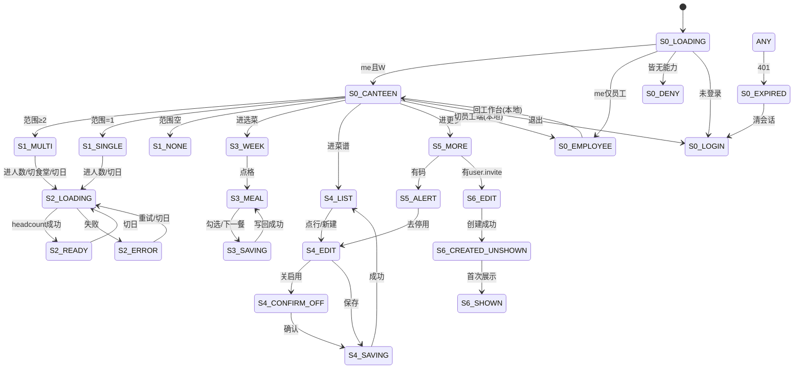

# 食堂竖屏状态机

> 本文只写**状态 / 转移 / 跳转 / 业务门闩**，不写视觉、布局、字号、截图对照、人体工程学。
> 行为权威仍以一期需求 `docs/requirements-phase1.md` 为准；设计稿对照见 PR #27 分支（本文不复述）。
> 约定：`me = GET /api/me`；`W = 工作台能力`；`401 = 会话失效`。

## 1. 状态列表

### S0 会话与壳路由

- `S0_INIT`：启动，会话未判定。
- `S0_LOADING`：`me` 拉取中。
- `S0_LOGIN`：未登录（停留在登录/注册）。
- `S0_CANTEEN`：食堂壳（`W == true`）。
- `S0_EMPLOYEE`：员工壳（`W == false` 且有员工能力）。
- `S0_DENY`：皆无能力（无可用功能，只能退出）。
- `S0_EXPIRED`：`401`（任何状态可进，见 T-401）。

`W` 定义（任一命中）：`roles ∋ {canteen, admin, super_admin}`，
或 `permissions ∩ {menu.read, menu.write, optimizer.read, meal.admin_override, rating.admin_read,
comment.admin_read, user.invite, export.run, audit.read, system.super,
rating.strong_alert_config, user.recover} ≠ ∅`。

### S1 食堂范围（壳内全局条件）

- `S1_NONE`：可管食堂集合为空。
- `S1_SINGLE`：恰 1 个（范围恒定，无需选择事件）。
- `S1_MULTI(c)`：≥2 个，当前值为 `c`（`super_admin` 取全量，其余按 `roles[].canteen_ids` 过滤）。

### S2 人数

- `S2_LOADING(c, d)`：拉取 `(canteen=c, date=d)` 中。
- `S2_READY(c, d, locked)`：有数，`locked ∈ {true, false}`（整日一次，不按餐分）。
- `S2_ERROR(c, d)`：拉取失败（可重试）。
- `S2_EMPTY`：`S1_NONE` 时的空分支（不拉取）。

### S3 选菜

- `S3_WEEK`：周视图（`周一..日 × {早,午,晚}` 格集合）。
- `S3_MEAL(m)`：当餐选定（`m` 为某一 `(day, slot)`）。
- `S3_SAVING(m, delta)`：勾选 `delta` 写回中。
- `S3_NOPERM`：`¬optimizer.read`（隐藏或阻断分支）。

### S4 菜谱

- `S4_LIST(f)`：列表（`f ∈ {菜,饭,汤}` 为当前分组条件）。
- `S4_EDIT(id?)`：编辑（`id` 为空＝新建；类型 `∈ {菜,饭,汤}`，启用 `∈ {on, off}`）。
- `S4_CONFIRM_OFF(id)`：停用待确认（`on → off` 必经，不可跳过）。
- `S4_SAVING(id)`：表单写回中。
- `S4_READONLY`：`¬menu.write`（列表可进，写转移全关）。

### S5 反馈与管理（更多子节点）

- `S5_MORE`：更多根（各子项按权限码显隐，空组不出现）。
- `S5_ALERT`：强提醒（待处理项集合；本节点**无下架转移**，只有 `→ S4_EDIT(id)` 转移）。
- `S5_RATING` / `S5_COMMENT`：评分汇总 / 评语（只读分支；评语无硬删转移）。
- `S5_OVERRIDE`：截止后改单（需 `meal.admin_override`）。
- `S5_ACCOUNT`：账户（人人可进）；`S5_DEVICE`（Web 需 `device.approve`）。

### S6 邀请码（一次性）

- `S6_EDIT`：创建参数态（角色 `∈ {员工,食堂}`，食堂范围，次数）。
- `S6_CREATED_UNSHOWN`：已创建、码未展示。
- `S6_SHOWN`：已展示一次（**终态**：无转移能回到可展示，刷新/重进也不重显）。

### S7 双角色位置

- `S7_CANTEEN`：位于食堂壳（默认）。
- `S7_EMPLOYEE`：位于员工壳。
- 互切只改本地位置，不触会话（无登录事件）。

## 2. 状态变化（转移）

`源 --事件/条件--> 目标`。权限不足的转移直接不存在（节点不可达），不做“点了再报错”的分支。

### T0 会话/路由

- `S0_INIT --启动--> S0_LOADING`。
- `S0_LOADING --me 拉取成功 ∧ W--> S0_CANTEEN`（双角色默认进此分支）。
- `S0_LOADING --me 拉取成功 ∧ ¬W ∧ 有员工能力--> S0_EMPLOYEE`。
- `S0_LOADING --me 拉取成功 ∧ 皆无能力--> S0_DENY`。
- `S0_LOADING --未登录--> S0_LOGIN`。
- `S0_LOGIN --登录/注册成功 ∧ me(W)--> S0_CANTEEN`；`--登录成功 ∧ me(仅员工)--> S0_EMPLOYEE`。
- `ANY --401--> S0_EXPIRED --清会话--> S0_LOGIN`。
- `S0_DENY --退出--> S0_LOGIN`。

### T1 范围

- `进壳 --managedCanteens()==∅--> S1_NONE`；`==1--> S1_SINGLE`；`≥2--> S1_MULTI(c0)`（`c0` 为首个）。
- `S1_MULTI(c) --选择 c'--> S1_MULTI(c')`（Web：全局 `canteenId` 改值，子节点重拉；见下如实注）。
- `S1_NONE --超管建食堂成功--> S1_SINGLE/S1_MULTI`（后置总管分支）。

### T2 人数

- `S1_SINGLE/S1_MULTI(c) --进入/切日 d--> S2_LOADING(c, d)`（`d` 默认上海时区今天，`±1天` 为切日事件）。
- `S2_LOADING --headcount 返回--> S2_READY(c, d, locked)`。
- `S2_LOADING --失败--> S2_ERROR --重试/切日--> S2_LOADING`。
- `S2_READY(c, d, _) --切日 d'--> S2_LOADING(c, d')`。
- 门闩：`locked` 为整日值，**不存在按餐锁定的状态**；锁定判定只读 `headcount.locked`。
- 如实注：Android C1 顶栏选择值与人数 `(c)` 未绑定——`S1_MULTI(c')` 转移后人数仍停留在旧 `c`
  的 `S2_READY`，需重进才变；Web 已绑定（`c` 改则人数重拉）。

### T3 选菜

- `S3_WEEK --点格 m--> S3_MEAL(m)`；`S3_MEAL --返回--> S3_WEEK`。
- `S3_MEAL(m) --勾选/取消 delta--> S3_SAVING(m, delta) --写回成功--> S3_MEAL(m')`
 （`m'` 为更新后集合；失败回 `S3_MEAL(m)` 并标记错误）。
- `S3_MEAL(m) --保存并下一餐--> S3_SAVING --成功--> S3_MEAL(next(m))`（`next` 按需求顺序）。
- `¬optimizer.read --进入--> S3_NOPERM`（无其它出边）。
- 门闩：勾选即时写回（无“暂存再提交”状态）；偏好值不进入状态（无分数展示态）。

### T4 菜谱

- `S4_LIST(f) --切分组 f'--> S4_LIST(f')`。
- `S4_LIST --点行 id--> S4_EDIT(id)`；`--新建--> S4_EDIT(∅)`（新建＝空 `id`，默认 `启用=on`）。
- `S4_EDIT --保存--> S4_SAVING --成功--> S4_LIST`；失败回 `S4_EDIT`。
- `S4_EDIT(id, on) --关启用--> S4_CONFIRM_OFF(id) --确认--> S4_SAVING --成功--> S4_LIST`；
  `--取消--> S4_EDIT(id, on)`。
- `S5_ALERT --去停用 id--> S4_EDIT(id)`（唯一出边，不存在列表直接下架的转移）。
- `¬menu.write --进入--> S4_READONLY`（`S4_EDIT/S4_SAVING/S4_CONFIRM_OFF` 不可达）。

### T5 更多/反馈/管理/账户

- `S0_CANTEEN --进更多--> S5_MORE --选子项--> {S5_ALERT, S5_RATING, S5_COMMENT, S5_OVERRIDE,
  S6_EDIT, S5_ACCOUNT, S5_DEVICE, 总管子节点}`（子项存在 ⟺ 对应权限码持有；无码则边不存在）。
- 子节点 `--返回--> S5_MORE`。
- 强提醒门闩：`S5_ALERT` 无 `→停用` 边，只能 `→ S4_EDIT`。
- 评语门闩：无硬删边；无“无分评语”状态（不可只评不打分）。

### T6 邀请码

- `S6_EDIT --创建成功--> S6_CREATED_UNSHOWN --首次展示--> S6_SHOWN`。
- `S6_SHOWN` 无出边（返回/重进/刷新均不重显；需新码重走 `S6_EDIT`）。
- 门闩：`user.invite` 缺失则 `S6_EDIT` 不可达。

### T7 双角色

- `S7_CANTEEN --切换到员工端--> S7_EMPLOYEE`（条件：持有 `meal.self_read ∨ shift.self_write`）。
- `S7_EMPLOYEE --切换到食堂工作台--> S7_CANTEEN`（条件：`W`）。
- 两转移均无登录/登出事件，会话保持。

## 3. 跳转关系

边清单（与图一致）：登录→壳三分支；壳→范围三分支；范围→人数拉取；人数切日/重试环；
选菜周视图⇄当餐＋写回环＋下一餐；菜谱列表⇄编辑＋停用确认子环；强提醒→编辑单向边；
更多→各子节点→返回；邀请码单向链至终态；双角色双向本地边；退出边；`401` 全局边。

## 4. 实现对照（状态覆盖）

| 状态 / 转移 | Web 窄屏（PR #27） | Android | 阶段 |
|-------------|-------------------|---------|------|
| T0 按 `me` 进壳三分支，401 全局边 | 已接 | 已接 | C1 |
| T7 双角色互切（无会话事件，默认食堂壳） | 已接 | 已接 | C1 |
| S1 范围三态 | 已接（全局范围，子节点重拉） | 半接：`S1_MULTI(c')` 转移后人数不跟随（§2 T2 如实注） | C1（绑定待后续） |
| S2 人数 `LOADING/READY/ERROR/EMPTY`＋整日锁门闩 | 已接 | 已接真数据 | C1 |
| S3 周视图/当餐/写回环/下一餐，`NOPERM` 分支 | 已接 | 未做（无此状态） | C3 |
| S4 列表/编辑/确认停用/写回环，只读分支 | 已接 | 未做（无此状态） | C2 |
| S5 强提醒→编辑单向边（无直接下架边） | 已接 | 未做 | C4 |
| S5 评分/评语只读分支 | 已接 | 未做 | C4 |
| S5 改单分支（`meal.admin_override`） | 已接 | 未做 | C5 |
| S6 创建→未展示→已展示终态（无回边） | 已接 | 未做 | C5 |
| S5 账户/设备/退出边 | 已接 | 部分：账户名＋双角色边＋退出边已接；设备分支复用员工壳 | C1 |
| 总管分支组（后置） | 已接 | 未做 | C5+ |
