# 食堂竖屏状态机

> 本文只写**状态 / 转移 / 跳转 / 业务门闩**，不写视觉、布局、字号、截图对照、人体工程学。
> 行为权威仍以一期需求 `docs/requirements-phase1.md` 为准；设计见同目录 `canteen-portrait.md`（已合入）。
> 约定：`me = GET /api/me`；`W = 工作台能力`；`401 = 会话失效`。

## 1. 状态列表

### S0 会话与壳路由

- `S0_INIT`：启动，会话未判定。
- `S0_LOADING`：`me` 拉取中。
- `S0_LOGIN`：未登录（停留在登录/注册；Passkey/TOTP/邮箱 OTP/密码均收敛为登录成功事件，方法内锁次/冷却子状态不属本文）。
- `S0_CANTEEN`：食堂壳（`W == true`）。
- `S0_EMPLOYEE`：员工壳（`W == false` 且有员工能力）。
- `S0_DENY`：设计稿分支，实现未做——皆无能力时仍进 `S0_EMPLOYEE`（代码 `!hasWorkbench` 一律进员工壳，无“无可用功能”页）。
- `S0_EXPIRED`：`401`（任何状态可进，见 T-401）。

`W` 定义（任一命中）：`roles ∋ {canteen, admin, super_admin}`，
或 `permissions ∩ {menu.read, menu.write, optimizer.read, meal.admin_override, rating.admin_read,
comment.admin_read, user.invite, export.run, audit.read, system.super,
rating.strong_alert_config, user.recover} ≠ ∅`。

### S1 食堂范围（壳内全局条件）

- `S1_NONE`：可管食堂集合为空。
- `S1_SINGLE`：恰 1 个（范围恒定，无需选择事件）。
- `S1_MULTI(c)`：≥2 个，当前值为 `c`（`super_admin` 取全量，其余按 `roles[].canteen_ids` 过滤）。

### S2 人数

- `S2_LOADING(c, d)`：拉取 `(canteen=c, date=d)` 中。
- `S2_READY(c, d, locked)`：有数，`locked ∈ {true, false}`（整日一次，不按餐分）。
- `S2_ERROR(c, d)`：拉取失败（可重试）。
- `S2_EMPTY`：`S1_NONE` 时的空分支（不拉取）。

### S3 选菜

- `S3_WEEK(w)`：周视图（`w` 为周偏移，`0` 为本周；`周一..日 × {早,午,晚}` 格集合）。
- `S3_LOADING(x)`：拉取中（`x` 为周偏移 `w` 或当餐 `m`）。
- `S3_ERROR(x)`：拉取失败（可重试）。
- `S3_MEAL(m)`：当餐选定（`m` 为某一 `(day, slot)`）。
- `S3_SAVING(m, delta)`：勾选 `delta` 写回中。
- `S3_NOPERM`：`¬optimizer.read`（宽屏侧栏条目隐藏；竖屏 Tab 常显，进后拉取失败 toast，无阻断）。

### S4 菜谱

- `S4_LIST(f)`：列表（`f ∈ {菜,饭,汤}` 为当前分组条件）。
- `S4_ERROR(f)`：列表 `(f)` 拉取失败（MenuPage 无 try/catch、无重试 affordance；恢复靠重进页/切范围，状态机记为独立态）。
- `S4_EDIT(id?)`：编辑（`id` 为空＝新建；类型 `∈ {菜,饭,汤}`，启用 `∈ {on, off}`）。
- `S4_CONFIRM_OFF(id)`：停用待确认（`on → off` 必经，不可跳过）。
- `S4_SAVING(id)`：表单写回中。
- `S4_READONLY`：`¬menu.write`（MenuPage 无写门：新建/停用按钮照常可点，失败靠后端 403 toast；仅宽屏侧栏“编辑菜”条目隐藏）。

### S5 反馈与管理（更多子节点）

- `S5_MORE`：更多根（各子项按权限码显隐，空组不出现）。
- `S5_ALERT`：强提醒（待处理项集合；本节点**无下架转移**，只有 `→ S4_EDIT(id)` 转移）。
- `S5_RATING` / `S5_COMMENT`：评分汇总 / 评语（只读分支；评语无硬删转移）。
- `S5_OVERRIDE`：截止后改单（需 `meal.admin_override`），最小子转移：
  `OV_LOAD(target) --载入成功--> OV_EDIT --改--> OV_SAVE --保存成功--> OV_EDIT'`；
  `--载入失败--> OV_LOAD`（重试）或 `--返回--> S5_MORE`；`--保存失败--> OV_EDIT`（可重试）。
- `S5_ACCOUNT`：账户（人人可进；`username` 只读，改 `display_name`）；`S5_DEVICE`（Web 需 `device.approve`）。
- 总管组（后置；边存在条件＝对应权限码；Web 已有 / Android 未做）：
  `S5_EXPORT`（`export.run`）／`S5_AUDIT`（`audit.read`）／`S5_EMAIL`（`system.super`）／
  `S5_THRESHOLD`（`rating.strong_alert_config`）／`S5_RECOVER`（`user.recover`）／
  `S5_LLM`（`system.super`）／`S5_APP_SIGN`（`system.super`）／`S5_CREATE_CANTEEN`（超管；仅宽屏 sidebar 有入口，竖屏无此边）。

### S6 邀请码（一次性）

- `S6_LIST`：已有码集合（逐码 `∈ {使用中, 已用完, 已作废}`，由 `used_count/max_uses/revoked_at` 决定）。
- `S6_EDIT`：创建参数态（角色 `∈ {员工,食堂}`，食堂范围，次数）。
- `S6_CREATED_UNSHOWN`：已创建、码未展示。
- `S6_SHOWN`：已展示一次（**终态**：无转移能回到可展示，刷新/重进也不重显）。
- `S6_REVOKED(id)`：已作废（终态，不可再用于注册）。

### S7 双角色位置

- `S7_CANTEEN`：位于食堂壳（默认）。
- `S7_EMPLOYEE`：位于员工壳。
- 互切只改本地位置，不触会话（无登录事件）。

## 2. 状态变化（转移）

`源 --事件/条件--> 目标`。权限不足的转移直接不存在（节点不可达），不做“点了再报错”的分支。

### T0 会话/路由

- `S0_INIT --启动--> S0_LOADING`。
- `S0_LOADING --me 拉取成功 ∧ W--> S0_CANTEEN`（双角色默认进此分支）。
- `S0_LOADING --me 拉取成功 ∧ ¬W ∧ 有员工能力--> S0_EMPLOYEE`。
- `S0_LOADING --me 拉取成功 ∧ 皆无能力--> S0_EMPLOYEE`（设计稿的 `S0_DENY` 错误页未实现）。
- `S0_LOADING --未登录--> S0_LOGIN`。
- `S0_LOGIN --登录/注册成功 ∧ me(W)--> S0_CANTEEN`；`--登录成功 ∧ me(仅员工)--> S0_EMPLOYEE`。
- `ANY --401--> S0_EXPIRED --清会话--> S0_LOGIN`。

### T1 范围

- `进壳 --managedCanteens()==∅--> S1_NONE`；`==1--> S1_SINGLE`；`≥2--> S1_MULTI(c0)`（`c0` 为首个）。
- `S1_MULTI(c) --选择 c'--> S1_MULTI(c')`（Web：全局 `canteenId` 改值，子节点重拉；见下如实注）。
- `S1_NONE --超管建食堂成功--> S1_SINGLE/S1_MULTI`（仅宽屏 sidebar 有新建入口；竖屏无此边）。

### T2 人数

- `S1_SINGLE/S1_MULTI(c) --进入/切日 d--> S2_LOADING(c, d)`（`d` 默认上海时区今天，`±1天` 为切日事件）。
- `S1_MULTI(c) --选 c'--> S1_MULTI(c') --范围生效--> S2_LOADING(c', d)`（`d` 保持当前日期）。
- `S2_LOADING --headcount 返回--> S2_READY(c, d, locked)`。
- `S2_LOADING --失败--> S2_ERROR --重试/切日--> S2_LOADING`。
- `S2_READY(c, d, _) --切日 d'--> S2_LOADING(c, d')`。
- 门闩：`locked` 为整日值，**不存在按餐锁定的状态**；锁定判定只读 `headcount.locked`。
- 如实注：Android C1 顶栏选择值与人数 `(c)` 未绑定——`S1_MULTI(c')` 转移后人数仍停留在旧 `c`
  的 `S2_READY`，需重进才变；Web 已绑定（`c` 改则人数重拉）。

### T3 选菜

- `S3_WEEK(w) --上周/下周--> S3_LOADING(w') --拉取成功--> S3_WEEK(w')`；
  `--拉取失败--> S3_ERROR(w') --重试--> S3_LOADING(w')`。
- `S3_WEEK --点格 m--> S3_LOADING(m) --当餐成功--> S3_MEAL(m)`；
  `--当餐失败--> S3_ERROR(m) --重试--> S3_LOADING(m)`；`S3_MEAL --返回--> S3_WEEK`。
- `S3_MEAL(m) --勾选/取消 delta--> S3_SAVING(m, delta) --写回成功--> S3_MEAL(m')`
 （`m'` 为更新后集合；失败回 `S3_MEAL(m)` 并标记错误）。
- `S3_MEAL(m) --保存并下一餐--> S3_SAVING --成功--> S3_MEAL(next(m))`（`next` 按需求顺序）。
- `¬optimizer.read --宽屏--> 条目隐藏；--竖屏--> S3_WEEK/S3_MEAL 照常进，拉取失败 toast`（竖屏 OptimizePage 无权限门）。
- 门闩：勾选即时写回（无“暂存再提交”状态）；偏好值不进入状态（无分数展示态）。

### T4 菜谱

- `S4_LIST(f) --切分组 f'--> S4_LIST(f')`。
- `S4_LIST --点行 id--> S4_EDIT(id)`；`--新建--> S4_EDIT(∅)`（新建＝空 `id`，默认 `启用=on`）。
- `S4_EDIT --保存--> S4_SAVING --成功--> S4_LIST`；失败回 `S4_EDIT`。
- `S4_EDIT(id, on) --关启用--> S4_CONFIRM_OFF(id) --确认--> S4_SAVING --成功--> S4_LIST`；
  `--取消--> S4_EDIT(id, on)`。
- `S4_LIST(f) --列表拉取失败--> S4_ERROR(f) --重进页/切范围--> S4_LIST(f)`。
- `off → on` 不经确认：`S4_EDIT(id, off) --开启用--> S4_SAVING`；仅 `on → off` 必经 `S4_CONFIRM_OFF`。
- `S5_ALERT --去停用 id--> S4_EDIT(id)`（唯一出边，不存在列表直接下架的转移）。
- `¬menu.write --宽屏--> “编辑菜”条目隐藏；--竖屏/列表--> S4_LIST 照常进，写操作失败 toast`。

### T5 更多/反馈/管理/账户

- `S0_CANTEEN --进更多--> S5_MORE --选子项--> {S5_ALERT, S5_RATING, S5_COMMENT, S5_OVERRIDE,
  S6_LIST, S5_ACCOUNT, S5_DEVICE, 总管子节点}`（子项存在 ⟺ 对应权限码持有；无码则边不存在）。
- 子节点 `--返回--> S5_MORE`。
- `S5_MORE --退出登录--> S0_LOGIN`（退出事件清会话；确认框属 UI，不入状态机）。
- `S5_ACCOUNT --改显示名成功--> S5_ACCOUNT`（名称更新，会话不变）。
- `S5_ACCOUNT --自助改密成功--> S5_ACCOUNT`（保留当前会话，吊销该账号其它全部会话；
  超管找回则吊销全部含当前 → `S0_LOGIN`）。
- 检查更新：本期状态机不含（竖屏更多无此节点；更新能力在员工端复用）。
- 强提醒门闩：`S5_ALERT` 无 `→停用` 边，只能 `→ S4_EDIT`。
- 评语门闩：无硬删边；无“无分评语”状态（不可只评不打分）。

### T6 邀请码

- `S6_EDIT --创建成功--> S6_CREATED_UNSHOWN --首次展示--> S6_SHOWN`。
- `S6_SHOWN` 无出边（返回/重进/刷新均不重显；需新码重走 `S6_EDIT`）。
- `S6_EDIT --创建失败--> S6_EDIT`（参数保留，可改后重试）。
- `S6_LIST --作废 id--> S6_REVOKED(id)`（需确认；单向，不可恢复）。
- `S6_LIST --改次数（≥已用次数；改到等于已用即用尽）--> S6_LIST`。
- `凭码注册成功 --used_count++--> S6_LIST`（码被作废/用满则注册拒绝；canteen 码的新账号具 W，按 T0 进食堂壳；邀请码不发 admin/super_admin）。
- 门闩：`user.invite` 缺失则 `S6_EDIT` 不可达。

### T7 双角色

- `S7_CANTEEN --切换到员工端--> S7_EMPLOYEE`（条件：持有 `meal.self_read ∨ shift.self_write`）。
- `S7_EMPLOYEE --切换到食堂工作台--> S7_CANTEEN`（条件：`W`）。
- 两转移均无登录/登出事件，会话保持。

## 3. 跳转关系

```mermaid
stateDiagram-v2
  [*] --> S0_LOADING
  S0_LOADING --> S0_CANTEEN : me且W
  S0_LOADING --> S0_EMPLOYEE : me仅员工
  S0_LOADING --> S0_EMPLOYEE : 皆无能力(无DENY页)
  S0_LOADING --> S0_LOGIN : 未登录
  S0_CANTEEN --> S1_MULTI : 范围≥2
  S0_CANTEEN --> S1_SINGLE : 范围=1
  S0_CANTEEN --> S1_NONE : 范围空
  S1_NONE --> S2_EMPTY
  S1_MULTI --> S2_LOADING : 进人数/切食堂/切日
  S1_SINGLE --> S2_LOADING : 进人数/切日
  S2_LOADING --> S2_READY : headcount成功
  S2_LOADING --> S2_ERROR : 失败
  S2_ERROR --> S2_LOADING : 重试/切日
  S2_READY --> S2_LOADING : 切日
  S0_CANTEEN --> S3_WEEK : 进选菜(有码)
  S0_CANTEEN --> S3_NOPERM : 宽屏无码隐藏(竖屏照常进)
  S3_WEEK --> S3_LOADING : 切周/点格
  S3_LOADING --> S3_WEEK : 周拉取成功
  S3_LOADING --> S3_MEAL : 当餐拉取成功
  S3_LOADING --> S3_ERROR : 失败
  S3_ERROR --> S3_LOADING : 重试
  S3_MEAL --> S3_SAVING : 勾选/下一餐
  S3_SAVING --> S3_MEAL : 写回成功
  S3_MEAL --> S3_WEEK : 返回
  S0_CANTEEN --> S4_LIST : 进菜谱(有写码)
  S0_CANTEEN --> S4_READONLY : 宽屏编辑条目隐藏(列表无门)
  S4_LIST --> S4_ERROR : 列表失败
  S4_ERROR --> S4_LIST : 重进页/切范围
  S4_LIST --> S4_EDIT : 点行/新建
  S4_EDIT --> S4_CONFIRM_OFF : 关启用(on→off)
  S4_CONFIRM_OFF --> S4_SAVING : 确认
  S4_CONFIRM_OFF --> S4_EDIT : 取消
  S4_EDIT --> S4_SAVING : 保存/开启用
  S4_SAVING --> S4_LIST : 成功
  S0_CANTEEN --> S5_MORE : 进更多
  S5_MORE --> S5_ALERT : 有码
  S5_ALERT --> S4_EDIT : 去停用
  S5_ALERT --> S5_MORE : 返回
  S5_MORE --> S5_RATING : 有码
  S5_RATING --> S5_MORE : 返回
  S5_MORE --> S5_COMMENT : 有码
  S5_COMMENT --> S5_MORE : 返回
  S5_MORE --> S5_OVERRIDE : 有meal.admin_override
  S5_OVERRIDE --> S5_MORE : 返回
  S5_MORE --> S5_ACCOUNT : 恒有
  S5_ACCOUNT --> S5_MORE : 返回
  S5_MORE --> S5_DEVICE : 有device.approve
  S5_DEVICE --> S5_MORE : 返回
  S5_MORE --> S5_EXPORT : 有export.run(后置)
  S5_MORE --> S5_AUDIT : 有audit.read(后置)
  S5_MORE --> S5_EMAIL : 总管(后置)
  S5_MORE --> S5_THRESHOLD : 有码(后置)
  S5_MORE --> S5_RECOVER : 有码(后置)
  S5_MORE --> S5_LLM : 总管(后置)
  S5_MORE --> S5_APP_SIGN : 总管(后置)
  S5_MORE --> S5_CREATE_CANTEEN : 超管(仅宽屏;后置)
  S5_EXPORT --> S5_MORE : 返回
  S5_AUDIT --> S5_MORE : 返回
  S5_EMAIL --> S5_MORE : 返回
  S5_THRESHOLD --> S5_MORE : 返回
  S5_RECOVER --> S5_MORE : 返回
  S5_LLM --> S5_MORE : 返回
  S5_APP_SIGN --> S5_MORE : 返回
  S5_CREATE_CANTEEN --> S5_MORE : 返回
  S5_MORE --> S6_LIST : 有user.invite
  S6_LIST --> S6_EDIT : 新建
  S6_EDIT --> S6_CREATED_UNSHOWN : 创建成功
  S6_EDIT --> S6_EDIT : 创建失败
  S6_CREATED_UNSHOWN --> S6_SHOWN : 首次展示
  S6_LIST --> S6_REVOKED : 作废
  S6_LIST --> S6_LIST : 改次数
  S6_LIST --> S6_LIST : 凭码注册计数++
  S0_CANTEEN --> S0_EMPLOYEE : 切员工端(本地)
  S0_EMPLOYEE --> S0_CANTEEN : 回工作台(本地)
  S0_CANTEEN --> S0_LOGIN : 退出
  S5_MORE --> S0_LOGIN : 退出
  ANY --> S0_EXPIRED : 401
  S0_EXPIRED --> S0_LOGIN : 清会话
```

边清单（与图一致）：登录→壳两分支（设计稿的 DENY 页未实现，皆无能力进员工壳）；壳→范围三分支（含 `S1_NONE→S2_EMPTY`）；
范围→人数拉取（含切食堂完整边）；人数切日/重试环；选菜切周/点格经 LOADING＋ERROR 重试环、
周视图⇄当餐＋写回环＋下一餐、`NOPERM` 阻断分支；菜谱列表ERROR重试环、列表⇄编辑、
`on→off` 经确认（`off→on` 直达写回）、只读分支；强提醒→编辑单向边；
更多→各子节点（含总管命名态）→返回；邀请码列表⇄创建/改次数、创建失败自环、作废单向边、
展示单向链至终态；账户改名自环、改密会话边；双角色双向本地边；壳/更多退出边；`401` 全局边。

## 4. 实现对照（状态覆盖）

| 状态 / 转移 | Web 窄屏（#27 已合入） | Android | 阶段 |
|-------------|-------------------|---------|------|
| T0 按 `me` 进壳三分支，401 全局边 | 已接 | 已接 | C1 |
| T7 双角色互切（无会话事件，默认食堂壳） | 已接 | 已接 | C1 |
| S1 范围三态 | 已接（全局范围，子节点重拉） | 半接：`S1_MULTI(c')` 转移后人数不跟随（§2 T2 如实注） | C1（绑定待后续） |
| S2 人数 `LOADING/READY/ERROR/EMPTY`＋整日锁＋切食堂边 | 已接 | 已接真数据；EMPTY/切食堂绑定见 §2 T2 如实注 | C1 |
| S3 周视图(w)/切周/LOADING/ERROR/当餐/写回环/下一餐，NOPERM 分支 | 已接 | 未做（无此状态） | C3 |
| S4 列表/ERROR/编辑/确认停用（仅 on→off，off→on 直达）/写回环，只读分支 | 已接 | 未做（无此状态） | C2 |
| S5 强提醒→编辑单向边（无直接下架边） | 已接 | 未做 | C4 |
| S5 评分/评语只读分支 | 已接 | 未做 | C4 |
| S5 改单分支（`meal.admin_override`） | 已接 | 未做 | C5 |
| S6 创建→未展示→已展示终态（无回边） | 已接 | 未做 | C5 |
| S6 列表/作废/改次数，创建失败自环 | 已接 | 未做 | C5 |
| S5 改单子转移（载入→改→保存） | 已接 | 未做 | C5 |
| S5 账户改名/改密会话边 | 已接 | 未做（更多账户节点部分实现） | C1 |
| S5 总管命名态 / 分支组（后置；建食堂仅宽屏） | 宽屏已接/竖屏未接 | 未做 | C5+ |
| S5 更多退出边 | 已接 | 已接 | C1 |
| 检查更新转移 | 不含（本期无此节点） | 不含 | — |
| S5 账户/设备/退出边 | 已接 | 部分：账户名＋双角色边＋退出边已接；设备分支复用员工壳 | C1 |
